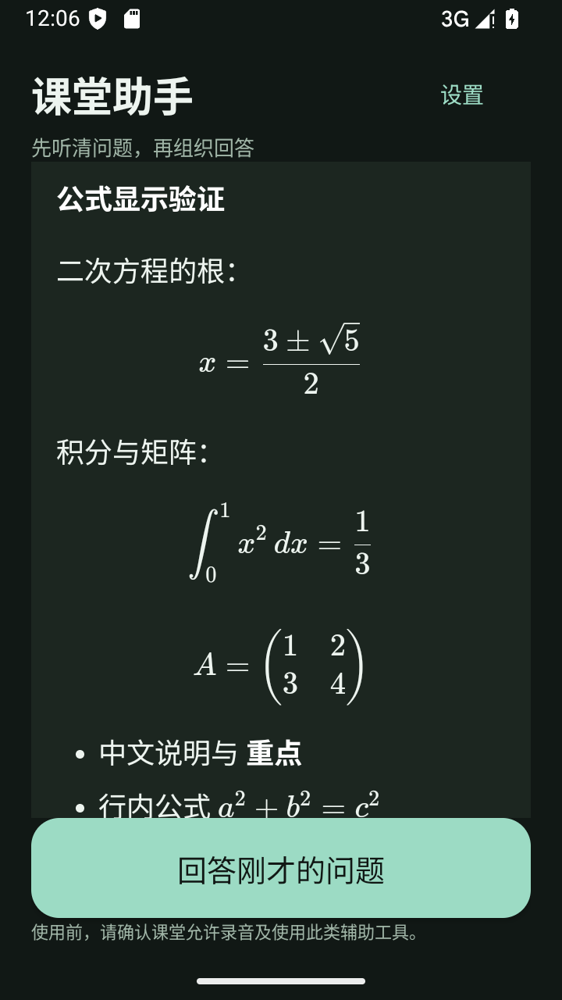

# 课堂助手

Android 本地语音识别与课堂问答工具。开始听课后可以后台、息屏录音；老师说完问题，点击回答即可，App 会先补齐最后一段识别，再请求模型。答案支持 Markdown 和常见 LaTeX 公式。

Android 8.0+，支持 ARM64 手机，另含 x86_64 模拟器运行库。安装包约 170 MB，包含 SenseVoice 离线模型；首次开始听课需要解压模型。

[下载安装包](https://github.com/cnxc519/classroom-assistant/releases/latest)



## 安装与使用

从本仓库 Releases 下载 APK。公开版连接作者的共享问答服务，安装后无需填写 API Key。共享服务需要联网，受每日额度、限流和服务器可用性影响。

1. 首次打开阅读使用说明，之后可在「设置 → 使用说明」查看。
2. 点「开始听课」，授予麦克风和通知权限，等待准备完成。建议先断开耳机，确认实际录音设备是手机内置麦克风。
3. 老师说完后点「回答刚才的问题」，不用等转写文字显示。识别较慢时仍需等待当前语音处理完成。
4. 没听清可回听最近 30 秒，或通过「修改 / 输入」纠正题目。下课后停止听课。

转写和模型答案都可能出错，尤其是数字、公式、专有名词和缺失条件。请核对关键内容。后台持续录音受手机系统限制，华为等设备可能需要手动允许后台运行。使用前确认课堂允许录音和此类辅助工具。

## 功能

- SenseVoiceSmall int8 + Silero VAD 本地识别；采集、识别分线程，有界任务队列。
- 优先申请手机内置麦克风，显示实际设备和音量；可改为跟随系统。
- 最近三分钟音频在内存循环保留，回答取最近 30–180 秒转写。停止后清除。
- 回答前补齐最后一段语音；支持取消、重试和手动输入。
- 流式答案支持列表、表格、代码，以及分式、根式、积分、矩阵等常见公式。支持 `\(...\)`、`\[...\]`、`$...$`、`$$...$$`，不支持完整 LaTeX 文档。复杂或不支持的命令可能显示为文字。
- 渲染库和字体随 APK 提供，不加载答案中的外部图片或链接；可复制答案原文。
- 服务端固定模型 `deepseek-flash`，显式设置 `thinking.type=disabled`。

## 数据与服务

音频仅在手机处理，不上传录音。点击回答时，最近转写或手动题目经 HTTPS 发送到问答服务器，再交给 DeepSeek。服务器不持久保存题目和答案，仅保存匿名限流、用量与会话元数据。见 [PRIVACY.md](PRIVACY.md)。

供应商密钥只放服务器环境文件，源码和 APK 均不包含密钥。每个安装自动获取有限期会话；会话不能阻止所有滥用。共享服务以每分钟、每设备和全局每日额度控制成本，默认全局每天最多 500 次、300,000 token 保守预算，达到上限后暂停至下一天。

## 构建

推荐 Windows PowerShell + JDK 17 + Android SDK 35 / build-tools 35.0.0：

```powershell
.\build.ps1 -AndroidSdk 'D:\SDK\Android' -JavaHome 'D:\JDK'
```

脚本从官方发布下载并校验 `dependency-hashes.json` 中的依赖，生成模型资源与 APK。默认依赖目录在项目同级 `asr-upgrade`，中间目录在同级 `build-public-v030`，输出在上两级 `outputs/Classroom-Assistant-v0.3.0.apk`，均可通过参数修改。首次下载需数百 MB，构建至少预留数 GB 空间。

脚本会生成本地测试签名；自行构建的签名与官方 Release 不同，通常无法覆盖官方安装。私有签名不在仓库。脚本遇到 `assets/personal-setup.json` 会拒绝构建公开版。

`build.gradle` 描述源文件布局，原生库和模型需先由脚本准备。自托管可修改 `AppSettings.API`，参考 [后端部署说明](backend/README.md)。

## 验证与限制

```sh
python -m unittest discover -s backend -p test_gateway.py -v
node tests/renderer/render.test.cjs
```

后端测试覆盖鉴权、限流、预算结算、模型参数、错误脱敏及取消后的资源释放。渲染测试覆盖常见公式、未完成片段和不可信 HTML/URL。安卓模拟器用于检查安装、首次说明与 WebView 显示，不能代替真实华为手机和教室实测。

独立安卓测试 APK 位于 `tests/android`，与应用同签名后安装，可通过 `am instrument -w -e live true cn.classroom.assistant.uitests/.UiSmoke` 验证实际 HTTPS 客户端和 WebView。`live true` 会消耗一次共享模型请求；省略则只验证公式。测试入口不包含在用户 APK 内。

识别升级曾以 10 条中文合成语音和 1 条公开真人样本进行 33 段小样本对比，模拟噪声结果不能代表真实教室、耳机或远距离收音，实际效果仍需在设备上确认。

应用代码使用 MIT 许可；模型和第三方依赖各自适用原许可，尤其 SenseVoice 模型使用自定义 FunASR 模型协议。见 [THIRD_PARTY_NOTICES.md](THIRD_PARTY_NOTICES.md)。
